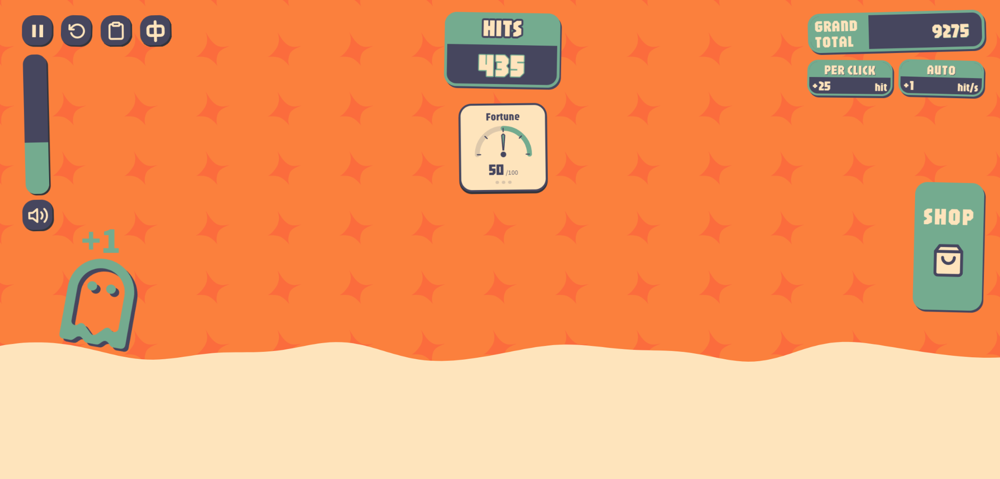
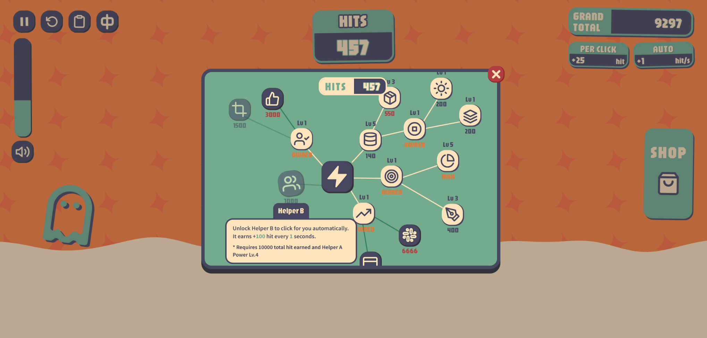

# Hit Clicker

A browser clicker game with Chinese and English language support.

**Click to earn hits, spend them on upgrades, and unlock new choices as your earnings grow.** The game is intended for people who enjoy lightweight clicker games and immediate feedback during short play sessions. I wanted to make a small interactive game that feels enjoyable and welcoming to someone like me, who has mild ADHD. The design starts with a simple click and uses numbers, sound and animation to give players real-time feedback on their actions, helping them decide where to spend their next hits.

Project repository: [Chubeiliang233/hit-clicker](https://github.com/Chubeiliang233/hit-clicker)

This branch contains the assignment submission. The [full development version](https://github.com/Chubeiliang233/hit-clicker/tree/development) includes the editing tools, tests and design documentation.

## Screenshots and Gameplay Video



The main screen displays the current balance, total earnings, earnings per click and earnings per second separately. Unlocked helpers earn hits automatically, the Fortune gauge shows the current Fortune value, and the background waves rise with total earnings.



The shop uses connections to show skill branches, with more nodes appearing as the player progresses. Hovering over a node reveals its effects, cost or prerequisites.

[Watch the gameplay recording (MOV)](docs/media/gameplay.mov).

## Core Interaction

The main gameplay loop is:

1. **Input: click an empty area.** Each valid click adds hits.
2. **Response and feedback: see and hear what changed.** The balance updates, accompanied by floating reward numbers, particles and click sounds. Repeated clicks also shake the HITS panel, speed up the rolling waves and release rising droplets.
3. **Choice: buy and upgrade skills in the shop.** Players can increase manual earnings, unlock automatic helpers, or develop the Lucky Click, Big Hit, Combo and Fortune branches.
4. **Outcome: change how efficiently hits are earned.** Upgrades increase future earnings, helpers begin working automatically, and new skills gradually appear. The player then decides which direction to develop next.

HITS is the current spendable balance, while GRAND TOTAL is the total number of hits earned. Purchases reduce the balance without reducing total earnings. Total earnings raise the water level; when it reaches the top, the wave becomes the new patterned background, and the next wave begins rising in the other colour.

Lucky Clicks, Big Hits and Combos provide additional reward feedback. Unlocking Fortune reveals a gauge, and Fortune affects the probability of a lucky click. Three dots indicate click progress towards the next Fortune update. See the [gameplay rules reference](docs/GAMEPLAY.md) for details.

## Controls

| Action                                                   | Result                                                                                     |
| -------------------------------------------------------- | ------------------------------------------------------------------------------------------ |
| Click an empty area on the main screen                   | Earn hits; clicking interface buttons does not generate additional manual earnings         |
| Click SHOP                                               | Open the skill tree                                                                        |
| Hover over a skill node                                  | View its description, cost, current and next-level values, or prerequisites                |
| Click a skill node                                       | Buy or upgrade it if the requirements are met and the balance is sufficient                |
| Drag an empty area in the shop                           | Pan the skill tree; arrow keys also work when the canvas has keyboard focus                |
| Click the lightning bolt at the centre of the skill tree | Re-centre the skill tree                                                                   |
| Click a close button or press Esc                        | Close the current dialog                                                                   |
| Click pause/resume in the top-left corner                | Pause or resume the game                                                                   |
| Click the circular arrow                                 | Open the reset confirmation; confirming clears game progress                               |
| Click the clipboard                                      | View the latest 100 income entries                                                         |
| Drag the volume slider / click the speaker               | Adjust the volume / toggle mute                                                            |
| Click E / 中                                             | Switch to the language indicated by the button                                             |
| Hover over or click the Fortune gauge                    | View the current lucky chance, progress towards the next Fortune update and related states |

On the first visit, the game selects Chinese or English according to the browser's language preferences, falling back to English for other languages. A manual language choice is remembered. Refreshing or resetting progress preserves both language and sound settings.

## How to Run

This is a static website built with HTML, CSS and JavaScript. Playing requires no dependency installation, build step, account registration or API keys.

**Single-file version:** download [hit-clicker.html](hit-clicker.html) and open the downloaded file in a modern browser. This file contains all game code, styles, images, fonts and both languages. It works offline on its own, without any companion files or folders. Font licenses and credits are also embedded in the file.

**Source version:** download and extract the whole repository, then open `index.html`. Keep `js/`, `styles/`, `assets/` and `locales/` alongside it; `index.html` alone is not the standalone export.

Alternatively, if Python 3 is installed, start a local static server from the project root:

```sh
python -m http.server 3000 --bind 127.0.0.1
```

Then open <http://127.0.0.1:3000>. On Windows, if Python is launched with `py`, replace `python` at the start of the command with `py -3`. Keep the terminal open while the server is running, and press Ctrl+C to stop it.

Python only serves local files here; it does not run the game logic. Fonts and images are bundled with the project, and sound is synthesised in the browser, so no external asset service is needed.

## Handling Interruptions and Known Limitations

- **Autosave:** Progress is stored in the current browser's localStorage and restored on refresh. There are no accounts, cloud saves or cross-device synchronisation. Clearing the browser's site data deletes the save. Opening a file directly and accessing it through a server may use different storage areas. The standalone export may also have a separate save from the source version.
- **Pausing and leaving the page:** Automatic earnings stop while the game is paused, the page is hidden or a reset confirmation is open. Earnings resume when play continues, without awarding income for time spent away.
- **Mistake prevention:** Resetting requires confirmation. No hits are spent if the balance is insufficient, prerequisites are unmet or the skill is already at its maximum level. Dragging the skill tree does not purchase skills, and each purchase is checked even during repeated input.
- **Unavailable storage or audio:** Save read/write failures provide recovery or retry controls. A save that cannot be read safely is not immediately overwritten. If audio is unavailable, the game continues without sound.
- **Display and motion:** Desktop and narrow-screen layouts are provided, and the game respects the system's reduced-motion preference. Automated browser testing primarily uses Edge; other browsers or unusual screen sizes may still display differences.

## Design, Collaboration and Credits

I created the interface design, edited the copy and made the iteration decisions. OpenAI Codex assisted with code implementation, Figma synchronisation, testing and project organisation. Font and asset sources, together with collaboration credits, are listed in [CREDITS.md](CREDITS.md).
